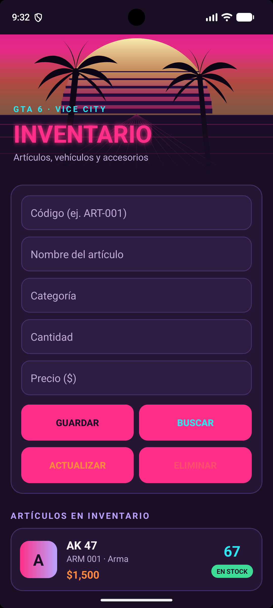
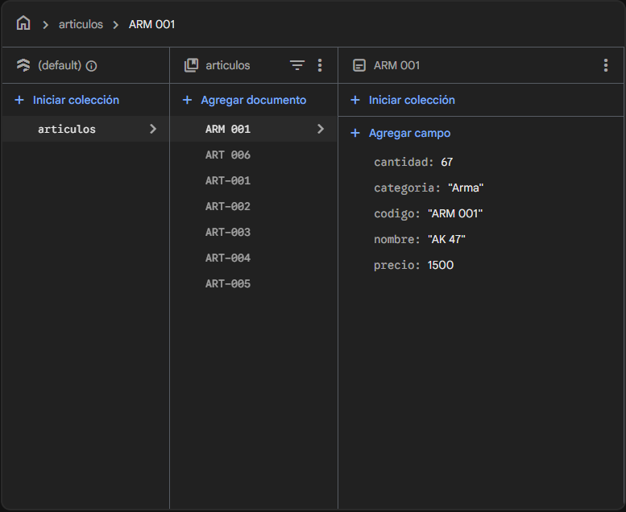
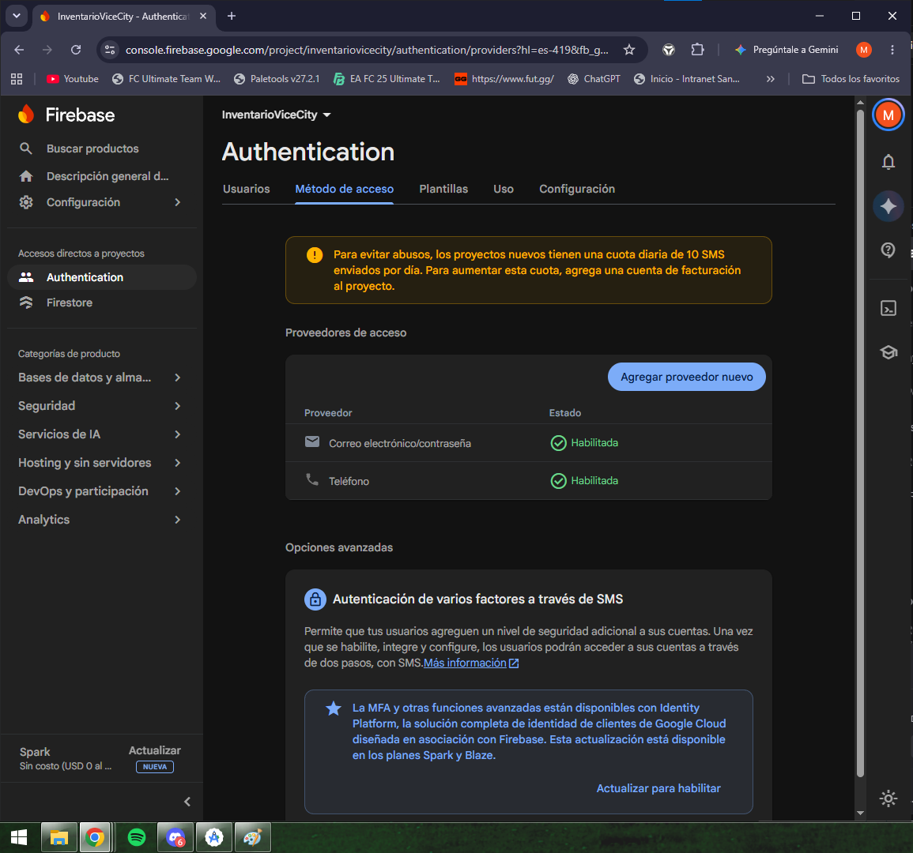
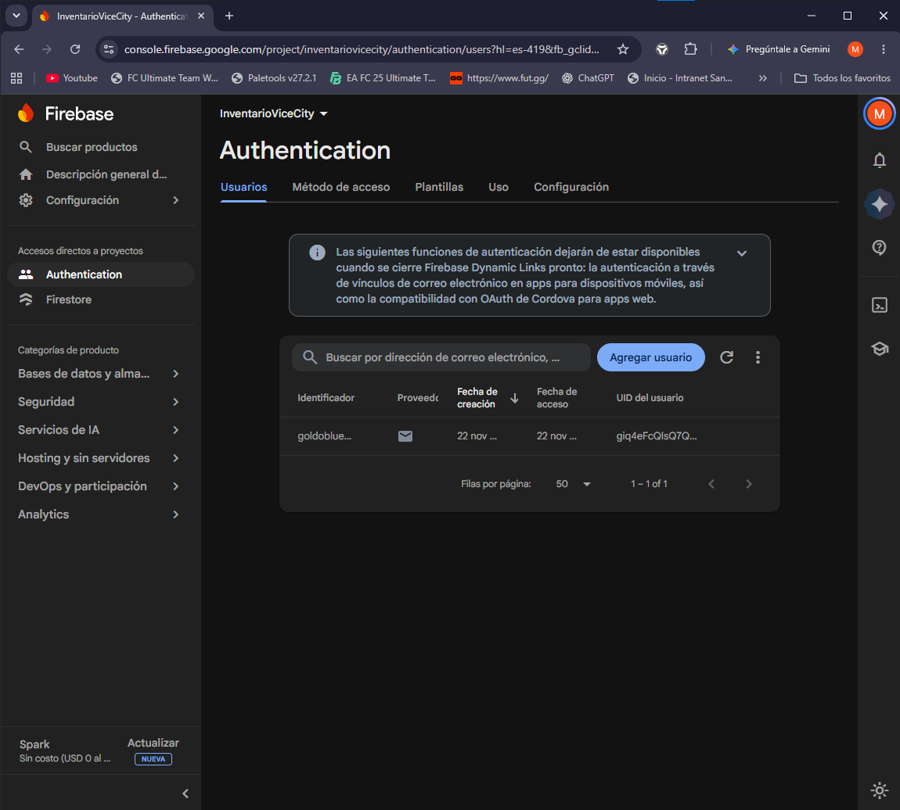

# Inventario ViceCity

Aplicación Android de inventario que guarda los artículos en una base local (SQLite) y los sincroniza con Cloud Firestore. Cada usuario inicia sesión con Firebase Authentication.

## Funcionalidades
- Registro e inicio de sesión con correo y contraseña (Firebase Authentication)
- Cerrar sesión
- Crear, listar, buscar, actualizar y eliminar artículos
- Base de datos local con SQLite y sincronización con Cloud Firestore
- Acceso restringido: solo los usuarios autenticados pueden usar la app

## Tecnologías
- Java, Android Studio
- SQLite
- Firebase Authentication
- Cloud Firestore
- Arquitectura por capas: `model`, `repositorio`, `viewmodel`, `ui`

## Capturas
| Registro | Base de datos (Firestore) |
|----------|---------------------------|
|  |  |

| Authentication | Authentication (usuarios) |
|----------------|---------------------------|
|  |  |

## Cómo ejecutar el proyecto
1. Clona el repositorio:
   `git clone https://github.com/Martin21SM/InventarioViceCity.git`
2. Abre el proyecto en Android Studio.
3. Crea un proyecto en [Firebase](https://console.firebase.google.com), registra la app con el paquete `com.devst.inventariovicecity` y habilita **Authentication (correo/contraseña)** y **Firestore**.
4. Descarga `google-services.json` y colócalo en la carpeta `app/`. Este archivo no se incluye en el repositorio por seguridad.
5. Sincroniza Gradle y ejecuta la app.

## Integrantes
- Martín Santibañez
- Samuel Bogarin

## Docente
- Pedro Gatica